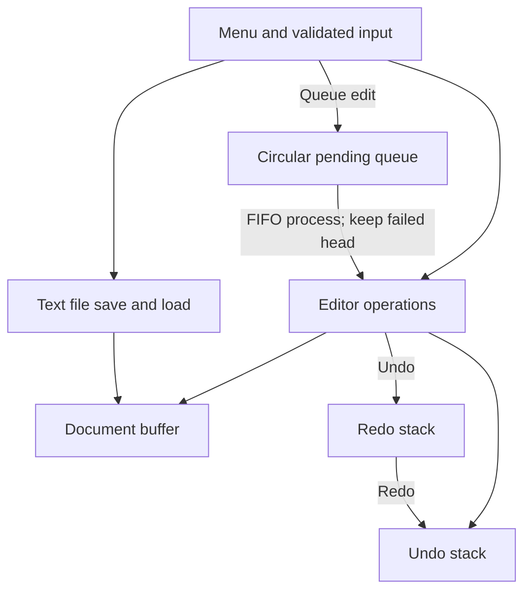

# Advanced C Text Editor

[](https://en.wikipedia.org/wiki/C_(programming_language))
[](https://www.iso.org/standard/29237.html)
[](LICENSE)

A small menu driven text editor that demonstrates editing a document in C with **Undo and Redo stacks** and a **circular FIFO queue** for deferred edits. It is intended as an understandable data structures project, not a full word processor.

## Objectives

- Practice arrays, stacks, circular queues, structures and file I/O in C.
- Apply edits at explicit 1-based positions and reverse/reapply them.
- Validate bounded input and report failures without losing queued work.

## Features

| Feature | Behavior |
|---|---|
| Insert | Insert a line of text before a 1-based character position; the end position appends. |
| Delete | Remove a requested positive number of characters from a position. |
| Replace | Replace a requested number of characters from a position with a line of text. |
| Undo / Redo | Restore the prior or next document snapshot. A successful new edit clears Redo. |
| Pending queue | Queue up to 32 edits and process them in FIFO order. A failing front item stays queued. |
| Save / Load | Read or write plain text files, with a 4095-character document limit. |
| History and statistics | Display stack contents, document size and collection capacities. |

The editor accepts one-line text values (no embedded newline) and stores a maximum of 4095 document characters. Positions are 1-based. Delete and Replace lengths must be positive. Undo history retains the most recent 64 successful edits; pending operations are limited to 32.

## Technologies and data structures

- C99 and the standard C library.
- **Undo stack:** stores the `before` and `after` document snapshots for each successful operation.
- **Redo stack:** stores the same snapshots when an operation is undone.
- **Circular pending queue:** fixed array with a front index and count; rear position is `(front + count) % capacity`.

Snapshots make the behavior easy to follow, at the cost of using more memory than a compact edit log. Each history stack has a fixed maximum capacity and discards its oldest item when full.

## Architecture




## Undo, Redo, and queued edits

Each edit is first applied to a temporary copy and committed only if its position, range, and resulting size are valid. The editor records the document before and after that change as one action. **Undo** restores the earlier snapshot and moves the action to Redo; **Redo** restores the later snapshot and moves it back to Undo. A new edit that changes the document clears Redo history.

Queued requests store the operation and its arguments in a fixed circular array. The queue processes its front item first and removes it only after the edit succeeds. If the document state makes an item invalid, processing stops and leaves that request at the front so it can be reviewed and retried after correcting the document.


## Example session

```text
Choice: 1
Position (1-based): 1
Text to insert: Hello, C!
Operation applied.
Choice: 10
Document (9 characters): Hello, C!
Choice: 4
Undid: Insert at position 1
Choice: 5
Redid: Insert at position 1
```


## Complexity

Let `n` be document length, `h` history capacity (64), and `q` queue capacity (32).

| Operation | Time | Extra space |
|---|---:|---:|
| Insert / Delete / Replace | O(n) due to shifting and snapshot copies | O(n) temporary and per history snapshot |
| Undo / Redo | O(n) snapshot copy | O(n) per stored action |
| Enqueue / Dequeue | O(1) | O(1) per queue entry |
| Process queue | O(q × n) worst case | O(n) per performed action |
| Save / Load | O(n) | O(n) while loading |

The two history arrays use O(h × n) snapshot storage; the queue uses O(q × input capacity).

## Limitations and future work

This is a single-document, single-line-at-a-time console editor with fixed limits. It does not support Unicode-aware character positions, multiline editing, automatic history grouping, configurable capacities, or crash recovery. Possible extensions include dynamic buffers, a line editor, a compact edit log, and a portable automated test runner.

